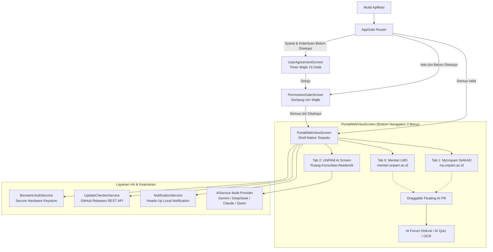

# UNPAM Mobile — Portal LMS & SIAKAD Terpadu Mahasiswa

[](https://flutter.dev)
[](https://dart.dev)
[](https://github.com/codewithtama/unpam_mobile/releases/tag/v1.0.17)
[-3DDC84?logo=android&logoColor=white)](https://android.com)
[](#keamanan--kepatuhan-privasi)

**UNPAM Mobile** adalah aplikasi portal terpadu untuk civitas akademika Universitas Pamulang yang menyatukan sistem pembelajaran digital (**Mentari LMS**) dan sistem informasi akademik (**MyUnpam SIAKAD**) ke dalam satu aplikasi native modern berkinerja tinggi. Aplikasi ini dilengkapi dengan asisten cerdas **UNPAM AI Multi-Engine**, autentikasi biometrik terenkripsi, gerbang persetujuan izin wajib, penanganan berkas perkuliahan otomatis, serta sinkronisasi riwayat pembaruan langsung dari GitHub API tanpa hardcode.

---

## Daftar Isi
1. [Fitur Utama](#fitur-utama)
2. [Arsitektur Sistem](#arsitektur-sistem)
3. [Daftar Fitur Mendalam](#daftar-fitur-mendalam)
4. [Struktur Direktori Proyek](#struktur-direktori-proyek)
5. [Spesifikasi Model AI (Per Oktober 2026)](#spesifikasi-model-ai-per-oktober-2026)
6. [Prasyarat & Cara Menjalankan](#prasyarat--cara-menjalankan)
7. [Kompilasi & Rilis APK](#kompilasi--rilis-apk)
8. [Keamanan & Kepatuhan Privasi](#keamanan--kepatuhan-privasi)

---

## Fitur Utama

* **Dual-Isolated Web Engine (Mentari LMS & MyUnpam SIAKAD)**: Memisahkan web controller Mentari dan MyUnpam menggunakan arsitektur `IndexedStack` sehingga berpindah menu tidak me-reload sesi atau menghilangkan jawaban kuis mahasiswa yang sedang berlangsung.
* **UNPAM AI Academic Assistant (Multi-Model AI)**: Asisten cerdas yang mendukung beragam provider LLM kelas dunia (Google Gemini 3.7/3.5, DeepSeek V4, Anthropic Claude 5.5, Alibaba Qwen 3.8-Max, OpenAI GPT-4o, dan OpenRouter).
* **Vision OCR Soal Kuis & Modul**: Memindai foto soal kuis atau tugas kuliah langsung dari kamera atau galeri dengan analisis optik multimodal.
* **AI Otomatis Isi Kuesioner Dosen**: Menganalisis form kuesioner evaluasi dosen di Mentari dan merancang draf catatan apresiasi konstruktif secara cerdas.
* **AI Parafrase Akademik**: Mengolah redaksi teks karya tulis dengan 4 pilihan gaya bahasa (Formal, Santai, Akademis, Ringkas) untuk mencegah duplikasi/plagiarisme.
* **Biometric Auto-Login Vault**: Masuk ke portal Mentari secara instan menggunakan sidik jari atau wajah dengan enkripsi perangkat keras (`flutter_secure_storage`).
* **Gerbang Izin Akses Wajib (Mandatory Permission Gatekeeper)**: Mewajibkan persetujuan seluruh izin perangkat penting (Notifikasi, Kamera, dan Penyimpanan Media) sebelum aplikasi dapat digunakan demi kelancaran fitur perkuliahan.
* **Riwayat Pembaruan Live dari GitHub API (Menu Titik 3)**: Menampilkan seluruh riwayat versi rilis beserta changelog lengkap yang ditarik langsung secara dinamis dari GitHub Releases tanpa hardcode.
* **Pembaruan Aplikasi Otomatis (In-App OTA Updater)**: Mendeteksi rilis versi terbaru secara real-time, menampilkan notifikasi melayang di status bar, dan menginstal APK secara langsung.
* **Syarat & Ketentuan Terproteksi (15s Mandatory Timer)**: Layar persetujuan etika penggunaan akademik dengan penghitung waktu mundur 15 detik untuk menjamin kepatuhan pengguna.

---

## Arsitektur Sistem



---

## Daftar Fitur Mendalam

### 1. Dual-Portal Mentari & MyUnpam
* **Mentari LMS (`mentari.unpam.ac.id`)**: Akses penuh ke materi kuliah, 21 sesi pertemuan, forum diskusi, penugasan, presensi, dan pengerjaan kuis interaktif tanpa gangguan proteksi Cloudflare Turnstile CAPTCHA.
* **MyUnpam SIAKAD (`my.unpam.ac.id`)**: Akses terpadu ke Sistem Informasi Akademik Mahasiswa: Pengisian KRS, Kartu Hasil Studi (KHS), Transkrip Nilai, Informasi Keuangan & Pembayaran Kuliah, serta Jadwal Ujian.
* **Penanganan Cerdas Berkas Cetak**: Otomatis mendeteksi unduhan berkas PDF (Cetak KRS, Cetak KHS, Kartu Ujian, dan Modul) agar langsung diteruskan ke aplikasi pembaca PDF eksternal di Android.

### 2. UNPAM AI Multi-Engine & Vision OCR
* **Draggable Floating Action Pill**: Tombol aksi mengambang yang dapat digeser bebas di atas WebView perkuliahan tanpa menutupi materi penting.
* **Fitur AI Terpadu**:
  * **AI Forum Diskusi**: Menganalisis topik pertanyaan diskusi dosen dan merancang argumen akademis yang orisinal.
  * **AI Quiz Recommender**: Menganalisis butir soal pilihan ganda, memberikan rujukan jawaban ilmiah beserta pembahasannya.
  * **Vision OCR Camera & Gallery**: Mengambil foto soal ujian dari kamera secara langsung atau memilih tangkapan layar dari galeri untuk dianalisis oleh AI multimodal.
  * **AI Parafrase Akademik**: Memformat ulang paragraf dengan perbandingan visual *side-by-side* dan opsi salin instan.
  * **AI Pengisian Kuesioner Dosen**: Mode cepat (semua "Ya") atau mode analisis mendalam untuk mengapresiasi kinerja pengajaran dosen.

### 3. Biometric Auto-Login Vault
* Mengeliminasi keharusan mengetik ulang NIM dan kata sandi Mentari setiap kali membuka aplikasi.
* Kredensial disimpan dengan enkripsi perangkat keras menggunakan `flutter_secure_storage` (Android Keystore).
* Dilengkapi lembar cepat konfirmasi sidik jari/wajah saat halaman formulir login terdeteksi.

### 4. Gerbang Persetujuan Izin Wajib (Mandatory Gatekeeper)
* Sebelum masuk ke portal, aplikasi memverifikasi 3 izin perangkat:
  1. **Notifikasi Sistem**: Menerima pengingat tenggat tugas, jadwal kuliah, dan rilis pembaruan aplikasi.
  2. **Kamera**: Diperlukan fitur UNPAM AI Vision OCR untuk memindai soal ujian dan catatan kuliah.
  3. **Penyimpanan & Galeri Foto**: Mengunggah berkas jawaban tugas mahasiswa ke portal Mentari/MyUnpam.
* Pengguna tidak dapat menggunakan aplikasi jika izin belum diberikan. Jika diblokir permanen oleh sistem, disediakan tombol langsung menuju menu Pengaturan HP (`openAppSettings()`) dan status diperbarui otomatis begitu kembali ke aplikasi.

### 5. Riwayat Pembaruan Live dari GitHub (Menu Titik 3)
* Diakses melalui menu titik tiga (`⋮`) di AppBar kanan atas $\rightarrow$ **"Riwayat Pembaruan"**.
* Terhubung secara live ke endpoint REST GitHub:
  `GET https://api.github.com/repos/codewithtama/unpam_mobile/releases?per_page=100`
* Menampilkan daftar rilis kronologis dari versi pertama hingga versi terkini lengkap dengan:
  * Badge **"Versi Terpasang Saat Ini"** pada versi yang sedang digunakan.
  * Tag rilis, judul, dan changelog pembaruan.
  * Tanggal rilis dalam bahasa Indonesia (WIB).
  * Ukuran file APK dan statistik jumlah unduhan.
  * Tombol **"Pasang"** langsung dari dialog riwayat rilis.
  * Dukungan *offline cache* via `SharedPreferences`.

---

## Struktur Direktori Proyek

```text
unpam_mobile/
├── .github/
│   └── workflows/
│       └── release-apk.yml               # CI/CD otomatis kompilasi APK rilis saat tag v* di-push
├── android/                              # Konfigurasi native Android (Gradle, Manifest, Keystore)
├── assets/                               # Aset statis (ikon, logo institusi UNPAM)
├── lib/
│   ├── core/
│   │   ├── constants/
│   │   │   └── api_constants.dart        # URL Mentari, MyUnpam, model AI, dan storage keys
│   │   └── services/
│   │       ├── ai_service.dart           # Engine komunikasi multi-provider AI & Vision OCR
│   │       ├── biometric_auth_service.dart # Layanan autentikasi biometrik & secure storage
│   │       ├── notification_service.dart # Layanan notifikasi lokal status bar Android
│   │       ├── permission_service.dart   # Manajemen & verifikasi status izin perangkat
│   │       ├── storage_service.dart      # Abstraksi SharedPreferences & cache sesi
│   │       └── update_checker_service.dart # Service GitHub Releases API & instalasi APK OTA
│   ├── models/
│   │   ├── ai_message_model.dart         # Model data pesan chat AI & kuis interaktif
│   │   ├── ai_model_config.dart          # Konfigurasi spesifikasi model AI terkini
│   │   ├── app_update_info.dart          # Metadata pembaruan & logika pembanding SemVer
│   │   ├── github_release.dart           # Model payload rilis GitHub API & format tanggal
│   │   └── paraphrase_model.dart         # Model gaya parafrase & perbandingan teks
│   ├── providers/
│   │   ├── ai_provider.dart              # State management UNPAM AI & penyimpanan riwayat
│   │   └── biometric_provider.dart       # State management status biometrik & kredensial
│   ├── screens/
│   │   ├── ai_assistant_screen.dart      # Layar percakapan AI, kuis, & Vision OCR
│   │   ├── ai_paraphrase_screen.dart     # Layar alat parafrase teks akademik
│   │   ├── permission_gate_screen.dart   # Layar gerbang persetujuan izin wajib
│   │   ├── portal_webview_screen.dart    # Shell utama Mentari, MyUnpam, & Floating AI
│   │   └── user_agreement_screen.dart    # Layar syarat & ketentuan dengan timer 15 detik
│   ├── theme/
│   │   └── app_theme.dart                # Desain sistem token warna institusi (Navy & Gold)
│   ├── widgets/
│   │   ├── app_gate.dart                 # Gateway penentu navigasi pada saat aplikasi dibuka
│   │   ├── biometric_quick_prompt_sheet.dart # Dialog konfirmasi biometrik saat form login tampil
│   │   ├── biometric_vault_sheet.dart    # Pengaturan kredensial login biometrik
│   │   ├── release_history_dialog.dart   # Dialog riwayat pembaruan sinkron GitHub API
│   │   └── update_dialog.dart            # Dialog konfirmasi & progress download update APK
│   └── main.dart                         # Entrypoint aplikasi, registrasi provider & tema
├── test/
│   └── widget_test.dart                  # Automated unit test & widget test suite (13 tests)
├── pubspec.yaml                          # Dependensi & versi aplikasi
├── RELEASE_NOTES.md                      # Changelog rilis publik aplikasi
└── README.md                             # Dokumentasi komprehensif proyek
```

---

## Spesifikasi Model AI (Per Oktober 2026)

Pengguna dapat memilih mesin kecerdasan buatan favorit di menu pengaturan AI:

| Provider | Model Rekomendasi Terkini | Model ID API | Kemampuan Utama |
| :--- | :--- | :--- | :--- |
| **Google Gemini** | Gemini 3.7 Flash, 3.5 Flash | `gemini-3.7-flash`, `gemini-3.5-flash` | Multimodal Vision OCR foto soal kuis, penalaran instan |
| **DeepSeek** | DeepSeek V4 Flash, V4 Pro | `deepseek-v4-flash`, `deepseek-v4-pro` | Konteks 1 Juta token, penalaran logika matematis mendalam |
| **Anthropic Claude**| Claude 5.5 (Sonnet, Haiku, Opus)| `claude-sonnet-5-5`, `claude-haiku-5-5` | Kerapian tata bahasa akademis, argumentasi terstruktur |
| **Alibaba Qwen** | Qwen 3.8-Max, 3.7-Max | `qwen-3.8-max`, `qwen-3.7-max` | Failover dual-region, kapabilitas teknis komprehensif |
| **OpenAI** | GPT-4o | `gpt-4o` | Penalaran multimodal umum dan penalaran cepat |
| **OpenRouter** | Router Bebas | Format `provider/model` | Akses ke ratusan model open-source/komersial global |
| **Cloud AI Gratis** | Cloud Native Serverless | Bawaan (Default) | Langsung dapat digunakan tanpa perlu memasukkan API key |

---

## Prasyarat & Cara Menjalankan

### Prasyarat Pengembangan
* **Flutter SDK**: Versi `3.19.0` atau lebih baru (direkomendasikan `3.41.7`)
* **Dart SDK**: Versi `3.0.0` atau lebih baru (direkomendasikan `3.11.5`)
* **Java Development Kit (JDK)**: Versi 17
* **Android SDK**: Min SDK 21 (Android 5.0 Lollipop), Target SDK 34 (Android 14)
* Perangkat Android fisik atau emulator dengan koneksi internet aktif.

### Langkah Menjalankan Aplikasi
```bash
# 1. Clone repositori
git clone https://github.com/codewithtama/unpam_mobile.git
cd unpam_mobile

# 2. Unduh paket dependensi
flutter pub get

# 3. Jalankan static analysis (Pastikan 0 warning / 0 error)
flutter analyze

# 4. Jalankan rangkaian pengujian otomatis
flutter test

# 5. Jalankan aplikasi pada perangkat Android
flutter run
```

---

## Kompilasi & Rilis APK

Proyek ini telah dikonfigurasi dengan skema penandatanganan ganda (**APK Signature Scheme v1 JAR + v2 Full**) agar terbebas dari kesalahan paket tidak valid pada perangkat vendor Android (Xiaomi MIUI/HyperOS, Samsung OneUI, ColorOS, dll).

### Kompilasi Lokal
```bash
# Membangun file APK rilis mandiri
flutter build apk --release
```
Berkas APK hasil build akan berlokasi di:
`build/app/outputs/flutter-apk/app-release.apk`

### CI/CD Otomatis via GitHub Actions
Setiap kali tag rilis di-push ke GitHub (contoh `git tag v1.0.17 && git push origin refs/tags/v1.0.17`), workflow `.github/workflows/release-apk.yml` akan secara otomatis:
1. Memeriksa integritas kode dan dependensi.
2. Mengompilasi berkas APK release bertandatangan resmi.
3. Menerbitkan GitHub Release baru dengan melampirkan berkas `app-release.apk` secara otomatis.

---

## Keamanan & Kepatuhan Privasi

1. **Integritas Sesi Mahasiswa**: Seluruh proses autentikasi akun Mentari dan MyUnpam berlangsung langsung di dalam peramban resmi Universitas Pamulang. Kata sandi tidak pernah dikirimkan ke server pihak ketiga mana pun.
2. **Penyimpanan Biometrik Terisolasi**: Kredensial login biometrik dienkripsi langsung oleh perangkat keras keamanan Android (*Hardware-backed Keystore*) melalui `flutter_secure_storage`.
3. **Kerahasiaan Kunci API AI**: Kunci API pengguna (Gemini, DeepSeek, Claude, Qwen, dsb.) disimpan secara eksklusif di perangkat lokal pengguna dan hanya dikirimkan langsung ke endpoint resmi masing-masing penyedia AI melalui saluran HTTPS TLS 1.3 terenkripsi.
4. **Pencegahan RenderFlex Overflow**: Seluruh komponen antarmuka dirancang fleksibel dengan toleransi terhadap skala teks besar (*Large Text Accessibility / WCAG AA*).
