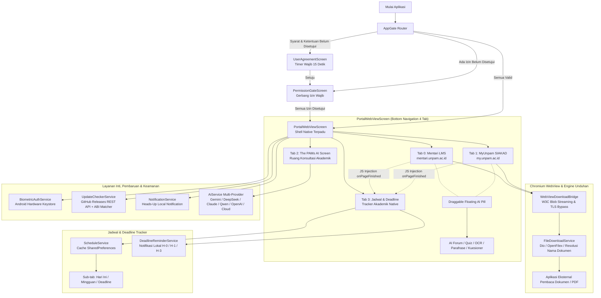

# The PAMs — Portal Perkuliahan & Akademik Terpadu

[](https://flutter.dev)
[](https://dart.dev)
[](https://github.com/codewithtama/unpam_mobile/releases/tag/v1.0.42)
[](test/widget_test.dart)
[-3DDC84?logo=android&logoColor=white)](https://android.com)
[](#keamanan--kepatuhan-privasi)

**The PAMs** adalah aplikasi portal perkuliahan dan akademik terpadu independen yang mengintegrasikan sistem pembelajaran daring (**Mentari LMS**) dan sistem informasi akademik (**MyUnpam SIAKAD**) Universitas Pamulang ke dalam satu wadah native modern berkinerja tinggi.

Aplikasi ini dirancang khusus untuk kenyamanan civitas akademika dengan menghadirkan **The PAMs AI Multi-Engine & Vision OCR**, **Jadwal Kuliah & Deadline Tracker**, autentikasi biometrik terenkripsi perangkat keras (*Android Keystore*), jembatan unduhan berkas akademik Chromium dengan ekstraksi memori browser (*skema `blob:`*), gerbang izin wajib (*permission gatekeeper*), sistem pembaruan aplikasi nirkabel (*In-App OTA Updater*), dan riwayat rilis live langsung dari GitHub REST API.

---

## Daftar Isi
1. [Fitur Utama](#fitur-utama)
2. [Arsitektur Sistem](#arsitektur-sistem)
3. [Daftar Fitur Mendalam](#daftar-fitur-mendalam)
4. [Struktur Direktori Proyek](#struktur-direktori-proyek)
5. [Spesifikasi Model AI (Per Oktober 2026)](#spesifikasi-model-ai-per-oktober-2026)
6. [Prasyarat & Cara Menjalankan](#prasyarat--cara-menjalankan)
7. [Kompilasi & Rilis APK](#kompilasi--rilis-apk)
8. [Keamanan & Kepatuhan Privasi](#keamanan--kepatuhan-privasi)

---

## Fitur Utama

* **Dual-Isolated Web Engine (Mentari LMS & MyUnpam SIAKAD)**: Memisahkan web controller Mentari dan MyUnpam menggunakan arsitektur `IndexedStack`. Berpindah antar tab portal tidak akan memicu reload halaman, merusak sesi login, atau menghilangkan input pengerjaan kuis mahasiswa yang sedang berjalan.
* **Jadwal Kuliah & Deadline Tracker**: Tab native keempat yang meng-scrape jadwal kuliah dari MyUnpam SIAKAD dan tenggat waktu tugas/kuis/ujian dari Mentari LMS secara otomatis via JS injection, dengan notifikasi reminder lokal H-0, H-1, H-3 dan cache SharedPreferences tanpa database tambahan.
* **Jembatan Unduhan Berkas Chromium & Ekstraksi Memori Blob W3C**: Mengatasi masalah unduhan berkas PDF (KRS, KHS, Jadwal Kuliah, Kartu Ujian, Modul LMS). Mendukung ekstraksi biner client-side *skema `blob:`* langsung dari RAM peramban secara streaming tanpa memicu penolakan *W3C Fetch credential*, serta otomatis memintas proteksi Cloudflare Turnstile CAPTCHA.
* **The PAMs AI Academic Assistant (Multi-Model Engine)**: Asisten cerdas terintegrasi yang mendukung berbagai provider LLM terdepan di dunia: Google Gemini 3.7/3.5 Flash, DeepSeek V4 (Flash & Pro), Anthropic Claude 5.5 (Sonnet & Opus), Alibaba Qwen 3.8-Max, OpenAI GPT-4o, OpenRouter, serta mode The PAMs Cloud AI Gratis tanpa kuota/API key.
* **Split-Screen AI Overlay & In-Page Contextual Action Pill**: Panel konsultasi AI mengambang split-screen dengan drag resize dan preset rasio layar tepat di atas portal, deteksi otomatis konteks halaman aktif (forum, tugas, kuis, materi), serta injeksi jawaban diskusi langsung ke form LMS.
* **Multimodal Vision OCR Kamera & Galeri**: Memindai tangkapan layar atau foto fisik soal kuis, modul materi, dan lembar tugas langsung dari kamera atau galeri untuk dianalisis oleh AI multimodal.
* **AI Solusi Diskusi & Kuis Interaktif**: Menganalisis butir soal pilihan ganda maupun esai forum diskusi, menyajikan opsi rujukan jawaban ilmiah beserta argumen pembahasannya.
* **AI Parafrase Akademik**: Mengolah redaksi teks karya tulis dan skripsi dengan 4 mode gaya bahasa (Formal, Santai, Akademis, Ringkas) serta tampilan perbandingan visual *side-by-side* guna mencegah indikasi plagiarisme/duplikasi.
* **AI Pengisian Kuesioner Evaluasi Dosen**: Memindai form evaluasi dosen di portal Mentari dan merumuskan draf catatan apresiasi konstruktif secara cerdas (mode cepat atau mode analisis mendalam).
* **Biometric Auto-Login Vault**: Mengeliminasi kebutuhan mengetik NIM dan kata sandi secara berulang. Kredensial disimpan dengan enkripsi tingkat perangkat keras (`flutter_secure_storage` / Android Hardware Keystore) dan diisi otomatis melalui verifikasi sidik jari atau sensor wajah.
* **Gerbang Izin Akses Wajib (Mandatory Permission Gatekeeper)**: Memastikan kelengkapan izin sistem Android (Notifikasi, Kamera, dan Media Penyimpanan) sebelum memasuki portal demi stabilitas seluruh fitur perkuliahan.
* **Riwayat Pembaruan Live dari GitHub API (Menu Titik 3)**: Menampilkan seluruh riwayat versi rilis beserta changelog lengkap yang ditarik secara dinamis dari GitHub Releases tanpa data hardcode, dilengkapi deteksi arsitektur CPU perangkat (*Split-per-ABI*).
* **Pembaruan Aplikasi Otomatis (In-App OTA Updater)**: Mendeteksi ketersediaan rilis versi baru secara silent di latar belakang, menampilkan Heads-up Notification di status bar Android, dialog unduhan berprogress, dan instalasi instan berkas APK via `open_filex`.
* **Syarat & Ketentuan Terproteksi (15s Mandatory Timer)**: Layar persetujuan etika penggunaan akademik dengan tombol persetujuan yang terkunci hingga hitung mundur 15 detik berakhir guna memastikan kesadaran integritas pengguna.

---

## Arsitektur Sistem



---

## Daftar Fitur Mendalam

### 1. Dual-Portal Mentari LMS & MyUnpam SIAKAD
* **Mentari LMS (`mentari.unpam.ac.id`)**:
  * Akses penuh ke materi perkuliahan 21 pertemuan, forum diskusi, penugasan, presensi mandiri, serta pengerjaan kuis interaktif.
  * Terbebas dari kendala proteksi Cloudflare Turnstile CAPTCHA berkat sinkronisasi native header dan User-Agent modern.
* **MyUnpam SIAKAD (`my.unpam.ac.id`)**:
  * Akses terpadu ke modul Sistem Informasi Akademik: Pengisian KRS, Kartu Hasil Studi (KHS), Transkrip Nilai Akademik, Jadwal Kuliah & Ujian, serta Informasi Tagihan Keuangan.
  * Mendukung pelacakan Single Sign-On (SSO) dan penanganan navigasi logout cerdas.
* **Manajemen State `IndexedStack`**:
  * Menjaga integritas halaman peramban saat pengguna berpindah tab. Jawaban kuis, draf diskusi, atau form KRS tidak akan hilang atau ter-refresh secara mendadak.

### 2. Jadwal Kuliah & Deadline Tracker *(Baru di v1.0.40)*
* **Tab Native Keempat**:
  * Hadir sebagai tab "Jadwal" (ikon kalender) di bottom navigation bar tanpa mengganggu tab portal yang sudah ada.
* **Scraping Otomatis via JavaScript Injection**:
  * Jadwal kuliah di-scrape dari tabel halaman MyUnpam SIAKAD secara otomatis saat halaman selesai dimuat (`onPageFinished`).
  * Deadline tugas, kuis, dan ujian di-scrape dari dashboard upcoming events, timeline, dan tabel penugasan Mentari LMS Moodle.
* **Tiga Sub-Tab Informatif**:
  * **Hari Ini**: Jadwal kuliah aktif pada hari berjalan dengan informasi ruang, jam, dan dosen.
  * **Mingguan**: Seluruh jadwal 7 hari ke depan dikelompokkan per hari dalam tampilan kartu kronologis.
  * **Deadline**: Daftar tugas/kuis/ujian diurutkan berdasarkan urgensi, dilengkapi kode warna merah (≤1 hari), oranye (≤3 hari), dan hijau (>3 hari), serta banner peringatan merah untuk deadline mendesak.
* **Notifikasi Reminder Lokal**:
  * `DeadlineReminderService` secara otomatis menampilkan notifikasi immediate saat ditemukan deadline H-0 (hari ini), H-1 (besok), dan H-3 (3 hari lagi).
  * Menggunakan kanal notifikasi tersendiri (`the_pams_deadline_reminder_v1`) agar tidak bertabrakan dengan notifikasi OTA.
* **Cache Lokal Tanpa Database Baru**:
  * Data jadwal dan deadline di-cache di `SharedPreferences` dengan indikator "terakhir diperbarui" dan tombol deep-link langsung ke portal terkait.
  * Zero dependensi baru — dibangun di atas `flutter_local_notifications` dan `shared_preferences` yang sudah ada.

### 3. Jembatan Unduhan Berkas Chromium & Ekstraksi Memori Blob (`blob:`)
* **Solusi Kendala Berkas Memori Browser**:
  * Memecahkan galat *"No host specified in URI blob:https://..."* yang umumnya terjadi pada peramban mobile saat menekan tombol **CETAK** pada menu Jadwal Kuliah, Cetak KRS, dan KHS MyUnpam.
  * Berkas PDF yang di-*generate* secara dinamis oleh JavaScript peramban (*client-side Blob*) langsung diekstraksi dari RAM peramban menggunakan transfer biner W3C compliant tanpa parameter credentials/headers kustom yang dilarang spesifikasi peramban modern.
* **Bypass Proteksi Unduhan Cloudflare Turnstile**:
  * Berkas yang memerlukan autentikasi diunduh menggunakan TLS engine, IP, dan cookie sesi aktif peramban Chromium melalui saluran `WebViewDownloadBridge`.
* **Penamaan Dokumen Otomatis & Kontekstual**:
  * Dokumen otomatis dinamai secara jelas sesuai konteks halaman aktif (contoh: `Jadwal_Kuliah_ThePAMs_...`, `Cetak_KRS_ThePAMs_...`, `KHS_ThePAMs_...`, dsb.).
  * Berkas yang telah selesai diunduh langsung dapat dibuka dengan satu ketukan melalui aplikasi pembaca PDF eksternal via `open_filex`.

### 4. The PAMs AI Multi-Engine & Multimodal Vision OCR
* **Draggable Floating Action Pill**:
  * Tombol aksi mengambang yang dapat dipindahkan secara bebas di atas WebView perkuliahan tanpa menghalangi materi penting.
* **Fitur Asisten Perkuliahan**:
  * **Vision OCR Camera & Gallery**: Memotret lembar soal ujian atau memilih tangkapan layar dari galeri untuk dibedah secara instan oleh kecerdasan buatan berbasis multimodal.
  * **AI Solusi Kuis & Forum Diskusi**: Menganalisis butir soal atau topik forum perkuliahan dan menghasilkan rujukan jawaban ilmiah beserta argumen pendukungnya.
  * **AI Parafrase Akademik**: Merumuskan ulang kalimat pada tugas atau skripsi dalam 4 mode gaya (Formal, Santai, Akademis, Ringkas) dengan komparasi visual sebelum-sesudah.
  * **AI Pengisian Kuesioner Evaluasi Dosen**: Menyediakan mode cepat (seluruh opsi positif) atau mode analisis mendalam untuk merumuskan catatan evaluasi yang santun dan konstruktif.

### 5. Biometric Auto-Login Vault
* Menghilangkan keharusan mengetik ulang NIM dan kata sandi akun portal setiap sesi dimulai.
* Kredensial sensitif dienkripsi langsung oleh modul perangkat keras keamanan Android (*Hardware-backed Keystore*) via `flutter_secure_storage`.
* Dilengkapi *Quick Prompt Sheet* yang muncul otomatis saat formulir masuk Mentari/MyUnpam terdeteksi di layar.

### 6. Gerbang Izin Akses Wajib (Mandatory Gatekeeper)
* Sebelum masuk ke portal utama, aplikasi memastikan 3 izin vital telah diberikan:
  1. **Notifikasi Sistem**: Menerima pemberitahuan tenggat waktu tugas, jadwal perkuliahan, dan ketersediaan pembaruan OTA.
  2. **Kamera**: Diperlukan fitur The PAMs AI Vision OCR untuk memindai lembar soal dan modul fisik.
  3. **Media Penyimpanan & Foto**: Mengunggah berkas lampiran tugas mahasiswa ke portal Mentari/MyUnpam.
* Jika izin ditolak permanen oleh pengguna, aplikasi menyediakan tombol langsung menuju menu Pengaturan Aplikasi HP (`openAppSettings()`) dan mendeteksi pemulihan status izin secara otomatis saat kembali ke aplikasi.

### 7. Riwayat Pembaruan Live & In-App OTA Updater
* **Riwayat Rilis Dinamis**:
  * Diakses melalui menu titik tiga (`⋮`) di AppBar kanan atas → **"Riwayat Pembaruan"**.
  * Terhubung secara live ke endpoint REST GitHub:
    `GET https://api.github.com/repos/codewithtama/unpam_mobile/releases?per_page=100`
  * Menampilkan badge **"Versi Terpasang Saat Ini"**, judul rilis, changelog lengkap, ukuran berkas, jumlah unduhan, dan format tanggal lokal Indonesia (WIB).
  * Dilengkapi *offline cache* via `SharedPreferences`.
* **Pemilih Berkas APK Cerdas Berbasis CPU ABI**:
  * Secara otomatis mencocokkan arsitektur chipset perangkat pengguna (`arm64-v8a`, `armeabi-v7a`, `x86_64`) untuk mengunduh berkas APK ringkas (~16MB–20MB) atau Universal fallback (~55MB), sehingga menghemat kuota internet mahasiswa.
* **In-App Updater Otomatis**:
  * Pengecekan versi terbaru secara berkala di latar belakang, pemberitahuan heads-up notifikasi, modal dialog unduhan berprogress, dan instalasi APK langsung.

---

## Struktur Direktori Proyek

```text
unpam_mobile/
├── .github/
│   └── workflows/
│       └── release-apk.yml                      # CI/CD otomatis kompilasi APK Split-per-ABI & rilis GitHub
├── android/                                     # Konfigurasi native Android (Gradle, Manifest, Keystore)
├── assets/                                      # Aset statis aplikasi (ikon & logo institusi)
│   └── icon/
│       └── app_icon.png                         # Ikon peluncur resmi The PAMs
├── lib/
│   ├── core/
│   │   ├── constants/
│   │   │   └── api_constants.dart               # URL portal, model AI, storage keys (jadwal, deadline, OTA)
│   │   └── services/
│   │       ├── ai_service.dart                  # Engine komunikasi multi-provider LLM & Vision OCR
│   │       ├── biometric_auth_service.dart      # Layanan autentikasi biometrik & secure hardware keystore
│   │       ├── file_download_service.dart       # Manajemen unduhan dokumen akademik & resolusi nama berkas
│   │       ├── notification_service.dart        # Layanan notifikasi lokal OTA status bar Android
│   │       ├── permission_service.dart          # Manajemen & verifikasi status izin perangkat Android
│   │       ├── storage_service.dart             # Abstraksi SharedPreferences & penyimpanan cache sesi
│   │       ├── update_checker_service.dart      # Layanan GitHub Releases API & OTA update installer
│   │       └── webview_download_bridge.dart     # Jembatan unduhan Chromium & W3C blob memory extractor
│   ├── features/
│   │   ├── ai_assistant/                        # Fitur: The PAMs AI Academic Assistant
│   │   │   ├── data/
│   │   │   └── presentation/
│   │   │       ├── providers/
│   │   │       │   └── ai_provider.dart         # State management AI: model, riwayat chat, Vision OCR
│   │   │       ├── screens/
│   │   │       │   ├── ai_assistant_screen.dart # Layar percakapan AI, kuis interaktif, & Vision OCR
│   │   │       │   └── ai_paraphrase_screen.dart# Layar alat parafrase teks ilmiah akademik
│   │   │       └── widgets/
│   │   │           └── mini_ai_overlay_panel.dart # Panel AI mengambang split-screen atas WebView
│   │   ├── auth/                                # Fitur: Autentikasi Biometrik
│   │   │   └── presentation/
│   │   │       └── widgets/
│   │   │           ├── biometric_quick_prompt_sheet.dart # Sheet cepat konfirmasi biometrik saat form login tampil
│   │   │           └── biometric_vault_sheet.dart        # Pengaturan kredensial login biometrik tersimpan
│   │   ├── onboarding/                          # Fitur: Onboarding & Permission Gate
│   │   │   └── presentation/
│   │   │       └── screens/
│   │   │           ├── user_agreement_screen.dart # Layar syarat & ketentuan dengan timer wajib 15 detik
│   │   │           └── permission_gate_screen.dart# Layar gerbang verifikasi persetujuan izin wajib
│   │   ├── portal/                              # Fitur: Shell Portal WebView Utama
│   │   │   ├── data/
│   │   │   │   └── scripts/
│   │   │   │       └── portal_js_scripts.dart   # JS injections: Biometrik, Blob, Jadwal & Deadline scrapers
│   │   │   └── presentation/
│   │   │       ├── screens/
│   │   │       │   └── portal_webview_screen.dart # Shell utama Mentari, MyUnpam, AI Pill & Tab Jadwal
│   │   │       └── widgets/
│   │   │           └── portal_bottom_nav.dart   # Bottom navigation bar 4 tab (Mentari/MyUnpam/AI/Jadwal)
│   │   ├── schedule/                            # Fitur: Jadwal Kuliah & Deadline Tracker
│   │   │   ├── data/
│   │   │   │   ├── schedule_service.dart        # CRUD cache jadwal & deadline di SharedPreferences
│   │   │   │   └── deadline_reminder_service.dart # Notifikasi reminder lokal H-0, H-1, H-3
│   │   │   ├── domain/
│   │   │   │   └── models/
│   │   │   │       └── schedule_model.dart      # Model CourseSchedule, CourseDeadline & DeadlineType enum
│   │   │   └── presentation/
│   │   │       ├── providers/
│   │   │       │   └── schedule_provider.dart   # State management jadwal & deadline (ChangeNotifier)
│   │   │       ├── screens/
│   │   │       │   └── schedule_screen.dart     # Layar 3 sub-tab: Hari Ini, Mingguan, Deadline
│   │   │       └── widgets/
│   │   │           ├── today_schedule_card.dart # Kartu jadwal kuliah hari ini
│   │   │           ├── weekly_schedule_view.dart# Tampilan jadwal mingguan dikelompokkan per hari
│   │   │           └── deadline_list_tile.dart  # Tile deadline dengan kode warna urgensi
│   │   └── updater/                             # Fitur: OTA Updater & Release History
│   │       ├── data/
│   │       ├── domain/
│   │       │   └── models/
│   │       │       ├── app_update_info.dart     # Metadata pembaruan & logika pembanding SemVer
│   │       │       └── github_release.dart      # Parser payload rilis GitHub API & pemilih aset ABI
│   │       └── presentation/
│   │           └── widgets/
│   │               ├── release_history_dialog.dart # Dialog riwayat pembaruan sinkron live GitHub API
│   │               └── update_dialog.dart       # Dialog konfirmasi & progress download pembaruan APK
│   ├── theme/
│   │   └── app_theme.dart                       # Sistem tema & token warna institusi (Navy & Gold)
│   └── main.dart                                # Entrypoint aplikasi, MultiProvider & inisialisasi layanan
├── test/
│   └── widget_test.dart                         # Rangkaian pengujian otomatis (25 unit & widget tests)
├── analysis_options.yaml                        # Aturan static analysis Dart & Flutter linter (strict mode)
├── devtools_options.yaml                        # Opsi konfigurasi Flutter DevTools
├── pubspec.yaml                                 # Dependensi paket & versi aplikasi (v1.0.40+40)
├── RELEASE_NOTES.md                             # Catatan rilis publik komprehensif
└── README.md                                    # Dokumentasi proyek
```

---

## Spesifikasi Model AI (Per Oktober 2026)

Pengguna dapat memilih mesin kecerdasan buatan favorit pada panel pengaturan The PAMs AI:

| Provider | Model Rekomendasi Terkini | Model ID API | Dukungan Vision OCR | Kemampuan Utama |
| :--- | :--- | :--- | :---: | :--- |
| **The PAMs Cloud AI** | Cloud Native Fast | `openai-fast` | Tidak | **Gratis tanpa kuota & tanpa API Key**. Cepat untuk tanya jawab umum & tugas perkuliahan. |
| **Google Gemini** | Gemini 3.8 Flash, 4 Argon | `gemini-3.8-flash` | **Ya** | Multimodal Vision OCR foto lembar soal kuis, jendela konteks 1 Juta token & kecepatan ultra tinggi. |
| **DeepSeek** | DeepSeek V4 (Flash / Pro) | `deepseek-v4-flash` | Tidak | Jendela konteks 1 Juta token, penalaran logika matematika, analisis algoritma & pemrograman. |
| **Anthropic Claude** | Claude Sonnet 5.5, Opus 5.5 | `claude-sonnet-5-5` | **Ya** | Penalaran akademis terstruktur, tata bahasa ilmiah elegan, analisis komprehensif jurnal. |
| **Alibaba Qwen** | Qwen 3.8-Max, 3.7-Max | `qwen3.8-max` | Tidak | Flagship Alibaba Cloud Model Studio dengan kecakapan teknis komprehensif & multibahasa. |
| **OpenAI** | GPT-5, GPT-4o | `gpt-5-mini` | **Ya** | Penalaran mutakhir dan pemahaman konteks multimodal teruji untuk beragam disiplin ilmu perkuliahan. |
| **OpenRouter** | Hub Multi-Model Bebas | Format `provider/model` | **Ya** | Satu API Key untuk mengakses ratusan model open-source maupun komersial global. |

---

## Prasyarat & Cara Menjalankan

### Prasyarat Pengembangan
* **Flutter SDK**: Versi `3.41.7` (Channel `stable`)
* **Dart SDK**: Versi `3.11.5`
* **Java Development Kit (JDK)**: Versi 17 (Eclipse Temurin direkomendasikan)
* **Android SDK**: Min SDK 21 (Android 5.0 Lollipop), Target SDK 34 (Android 14)
* Perangkat Android fisik atau emulator dengan koneksi internet aktif.

### Langkah Menjalankan Proyek
```bash
# 1. Clone repositori
git clone https://github.com/codewithtama/unpam_mobile.git
cd unpam_mobile

# 2. Unduh seluruh paket dependensi
flutter pub get

# 3. Jalankan static analysis (Harus 0 warning / 0 issue)
flutter analyze --no-fatal-infos

# 4. Jalankan rangkaian pengujian otomatis (25 unit & widget tests)
flutter test

# 5. Jalankan aplikasi pada perangkat target
flutter run
```

---

## Kompilasi & Rilis APK

Aplikasi menggunakan skema penandatanganan ganda (**APK Signature Scheme v1 JAR + v2 Full**) serta kompilasi terisolasi per arsitektur CPU untuk menjamin performa maksimal dan kompatibilitas penuh di seluruh varian vendor Android (Xiaomi HyperOS/MIUI, Samsung OneUI, ColorOS, OriginOS, dsb.).

### Kompilasi Lokal

```bash
# Kompilasi APK Split-per-ABI (~16MB - 20MB per arsitektur CPU)
flutter build apk --release --split-per-abi --obfuscate --split-debug-info=build/app/outputs/symbols
```

Berkas APK hasil kompilasi berlokasi di:
* `build/app/outputs/flutter-apk/app-arm64-v8a-release.apk` (HP Android Modern 64-bit)
* `build/app/outputs/flutter-apk/app-armeabi-v7a-release.apk` (HP Android 32-bit)
* `build/app/outputs/flutter-apk/app-x86_64-release.apk` (Emulator Android)

### CI/CD Otomatis via GitHub Actions
Setiap kali tag rilis di-push ke repositori GitHub (contoh: `git tag v1.0.40 && git push origin v1.0.40`), workflow `.github/workflows/release-apk.yml` akan secara otomatis:
1. Memverifikasi kode sumber dan mengunduh seluruh dependensi.
2. Mengonfigurasi keystore rilis bertandatangan resmi.
3. Mengompilasi varian APK ringan *Split-per-ABI* dengan proteksi kode `--obfuscate`.
4. Menerbitkan rilis baru di GitHub Releases dengan menyertakan changelog dari `RELEASE_NOTES.md` beserta seluruh berkas APK yang siap diunduh oleh pengguna.

---

## Keamanan & Kepatuhan Privasi

1. **Integritas Sesi & Kredensial Pengguna**:
   Seluruh proses autentikasi akun Mentari LMS dan MyUnpam SIAKAD diproses secara langsung di dalam peramban web resmi Universitas Pamulang. Kata sandi tidak pernah dikirimkan atau disimpan di server pihak ketiga mana pun.
2. **Penyimpanan Biometrik Terisolasi (Hardware-Backed Keystore)**:
   Kredensial login biometrik dienkripsi menggunakan standar keamanan perangkat keras Android melalui `flutter_secure_storage`.
3. **Kerahasiaan Kunci API AI**:
   API Key pengguna (Gemini, DeepSeek, Claude, Qwen, dsb.) tersimpan secara aman di ruang penyimpanan lokal perangkat dan hanya dikirimkan langsung ke endpoint resmi penyedia model terkait melalui koneksi terenkripsi HTTPS TLS 1.3.
4. **Isolasi Aliran Data Memori (Zero Data Leakage)**:
   Ekstraksi berkas memori *skema `blob:`* diproses secara lokal di dalam memori peramban tanpa perantara jaringan eksternal yang tidak aman.
5. **Penyimpanan Data Jadwal & Deadline Lokal**:
   Seluruh data jadwal kuliah dan tenggat waktu tugas yang di-scrape dari portal hanya disimpan di perangkat pengguna (`SharedPreferences`) dan tidak pernah dikirimkan ke server mana pun.
6. **Standar Aksesibilitas WCAG AA**:
   Seluruh antarmuka dirancang responsif terhadap pengaturan skala teks besar pada ponsel pengguna guna mencegah terjadinya *RenderFlex overflow*.
